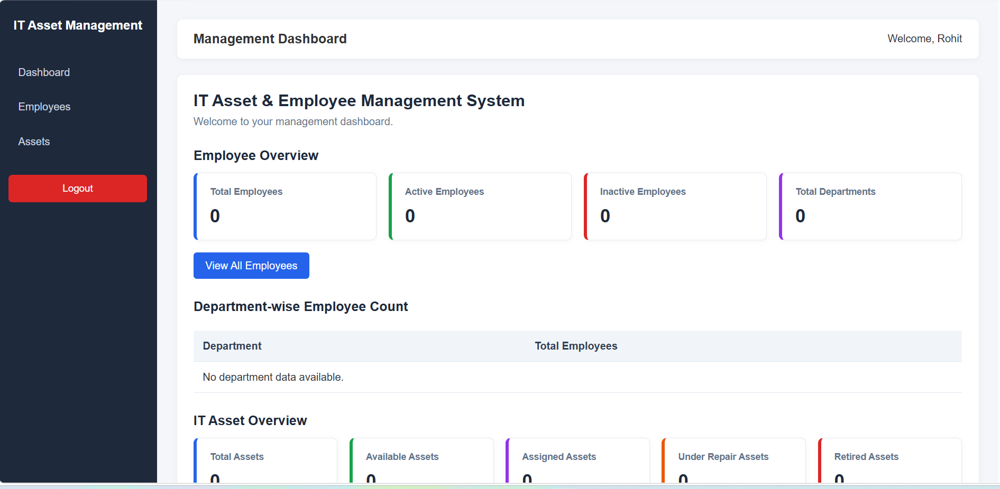
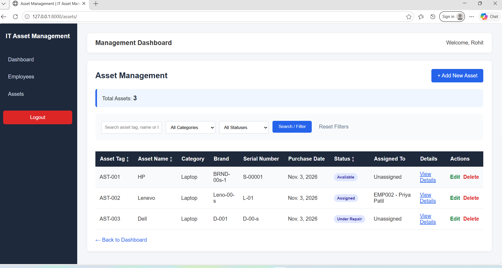
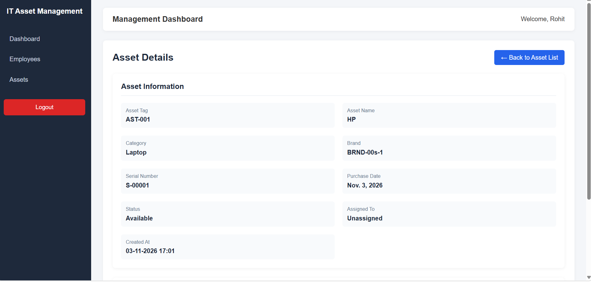
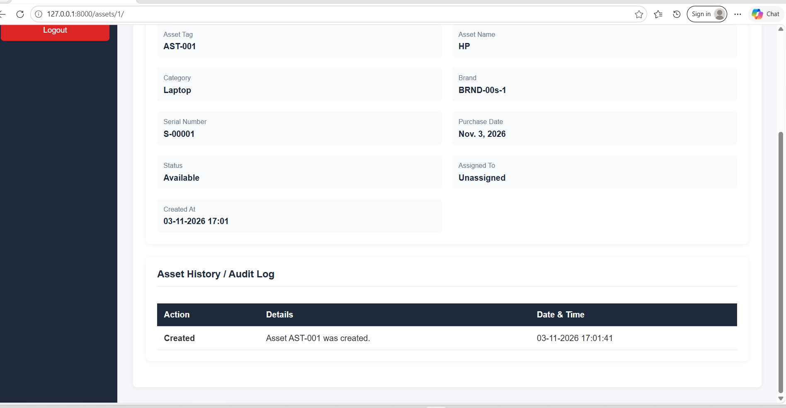

# IT Asset & Employee Management System

A Django-based web application to manage employees, IT assets, asset assignments, and asset history through a centralized dashboard.

## Project Overview

The IT Asset & Employee Management System helps organizations maintain employee records, track IT assets, manage asset assignments, and monitor asset activity.

This project was developed as a practical Django project using Python, Django, and SQLite.

## Features

### 1. Employee Management
- Add, view, update, and delete employees.
- Search employees by ID, name, email, and department.
- Filter employees by department and active/inactive status.
- Pagination for employee records.
- Employee detail page with assigned assets.
- Employee ID and email validation.
- Phone number validation.

### 2. Asset Management
- Add, view, update, and delete IT assets.
- Assign assets to employees.
- Track asset status:
  - Assigned
  - Available
  - Under Repair
  - Retired
- Search and filter assets.
- View asset details and assignment information.
- Asset history and audit log.
- Track asset creation, updates, and deletion.

### 3. Dashboard
- Total employee count.
- Active and inactive employee counts.
- Total asset count.
- Asset status summary.
- Department-wise employee information.

### 4. Authentication & Authorization
- Login and logout functionality.
- Login protection for application pages.
- Role-Based Access Control (RBAC).
- Admin and Staff user roles.
- Permission-based access to create, update, and delete operations.

### 5. User Interface
- Responsive dashboard layout.
- Shared navigation and sidebar.
- Success and error messages.
- Form validation and error handling.
- Delete confirmation pages.
- Employee and asset detail pages.

## Technologies Used

- Python 3.10.8
- Django 5.0.6
- SQLite3
- HTML5
- CSS3
- JavaScript
- Git
- GitHub
- Visual Studio Code

## Project Structure

```text
IT-ASSET-Employee-Management-System/
│
└── it_asset_manager/
    │
    ├── config/
    │   ├── manage.py
    │   ├── db.sqlite3
    │   ├── config/
    │   ├── employees/
    │   ├── assets/
    │   └── dashboard/
    │
    ├── templates/
    │   ├── base.html
    │   └── registration/
    │
    └── README.md
```

## Installation & Setup

### 1. Clone the Repository

```bash
git clone https://github.com/rohit08780/IT-ASSET-Employee-Management-System.git
```

### 2. Open the Project Directory

```bash
cd IT-ASSET-Employee-Management-System
```

Navigate to the `it_asset_manager/config` directory, where `manage.py` is located.

```bash
cd it_asset_manager/config
```

### 3. Create a Virtual Environment

```bash
python -m venv venv
```

### 4. Activate Virtual Environment (Windows)

```bash
venv\Scripts\activate
```

### 5. Install Django

```bash
pip install Django==5.0.6
```

### 6. Apply Database Migrations

```bash
python manage.py migrate
```

### 7. Create a Superuser

```bash
python manage.py createsuperuser
```

Follow the instructions to create your administrator account.

### 8. Run the Development Server

```bash
python manage.py runserver
```

Open the application in your browser:

**Application:**

http://127.0.0.1:8000/

**Django Admin:**

http://127.0.0.1:8000/admin/

## Database

This project uses SQLite3 as its database.

Main database models include:

- Employee
- Asset
- AssetHistory

ForeignKey relationships are used to manage employee and asset assignments.

## Role-Based Access Control

The application supports different user roles:

**Admin**
- Full access to employee and asset management.
- Can create, update, and delete records.

**Staff**
- Can view employee and asset information.
- Cannot create, update, or delete records without the required permissions.

## Learning Outcomes

Through this project, I practised:

- Django Models, Views, Templates, and Forms.
- CRUD operations.
- Database relationships using ForeignKey.
- Django Authentication and Permissions.
- Role-Based Access Control.
- Search, filtering, and pagination.
- Form validation and error handling.
- Asset assignment management.
- Asset history and audit logging.
- Git and GitHub version control.

## Author

**Rohit Khilari**

Python & Django Backend Developer

**GitHub:**  
https://github.com/rohit08780

**LinkedIn:**  
https://www.linkedin.com/in/rohit-khilari-8524bb228/

---

*This project was developed for practical learning and demonstration of Django web development skills.*

## Screenshots

### Dashboard


### Employee Management


.png)

### Asset Management


### Asset Detail


### Asset History / Audit Log
